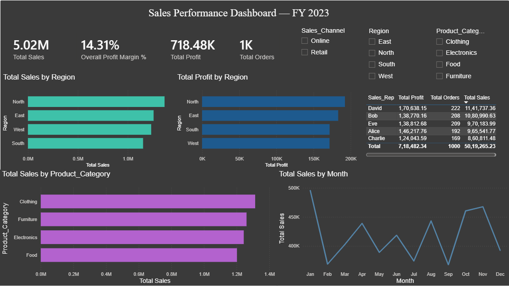

# Sales Data Dashboard (Power BI)

An interactive Power BI dashboard analyzing sales performance across regions,
product categories, sales reps, and time — tracking total sales, profit
margin, and regional performance with slicers and drill-down support.



## Overview
- **Total Sales:** ₹50.2 Lakh across 1,000 transactions (Jan 2023 – Jan 2024)
- **Overall Profit Margin:** 14.31%
- Tracks performance across 4 regions, 4 product categories, 5 sales reps,
  and 2 sales channels (Retail/Online)

## Features
- **4 KPI cards** — Total Sales, Profit Margin %, Total Profit, Total Orders
- **Regional performance** — Total Sales and Total Profit by Region,
  side by side (reveals that South ranks 4th in sales but 2nd in profit)
- **Category breakdown** — Total Sales by Product Category
- **Monthly trend** — Total Sales by Month (correctly sorted Jan → Dec)
- **Sales rep leaderboard** — ranked table with Total Sales, Profit, and Orders
- **Slicers** — Region, Product Category, and Sales Channel, so every visual
  filters together interactively

## Dataset
`sales_data.xlsx` — 1,000 sales transactions with Region, Product Category,
Sales Rep, Sales Amount, Quantity, Unit Cost/Price, Discount, Payment Method,
and Sales Channel. `Profit` and `Profit_Margin_%` were calculated from the
per-unit cost/price margin applied to each transaction's revenue.

## Files
- `Sales_Dashboard.pbix` — the Power BI dashboard file (open in Power BI Desktop)
- `sales_data.xlsx` — the underlying dataset
- `dashboard_screenshot.png` — a preview image (since .pbix files don't
  render directly on GitHub)

## Key DAX measures
```DAX
Total Sales = SUM('Sales Data'[Sales_Amount])
Total Profit = SUM('Sales Data'[Profit])
Overall Profit Margin % = DIVIDE([Total Profit], [Total Sales], 0)
Total Orders = COUNTROWS('Sales Data')
Average Order Value = DIVIDE([Total Sales], [Total Orders], 0)
```

## How to view
1. Download `Sales_Dashboard.pbix`
2. Open in [Power BI Desktop](https://powerbi.microsoft.com/desktop/) (free)
3. Interact with the slicers to filter by region, category, or channel
